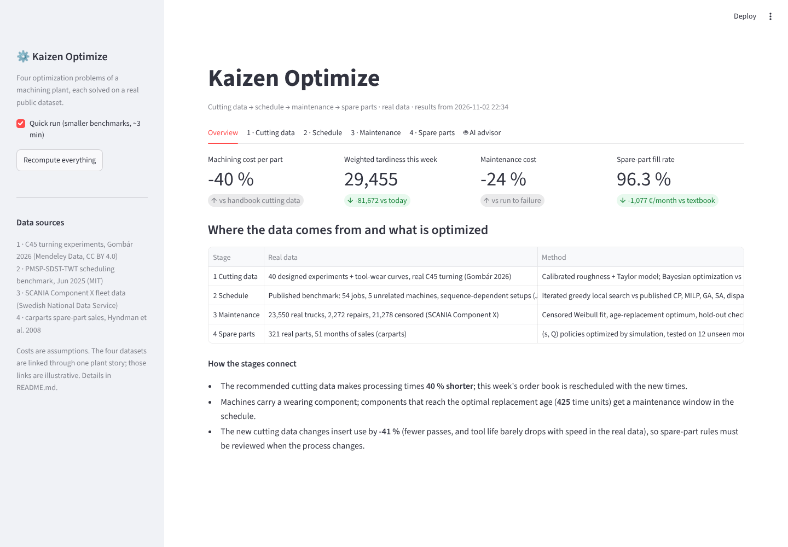
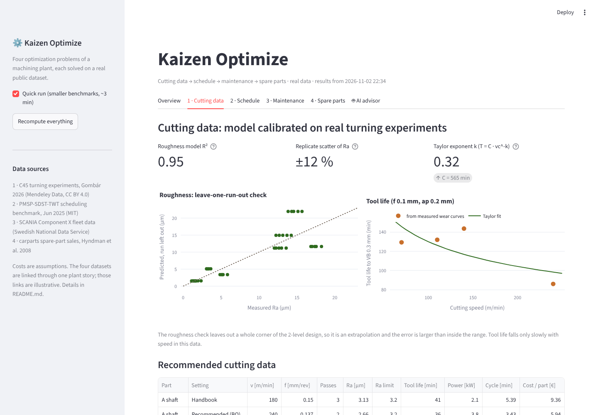
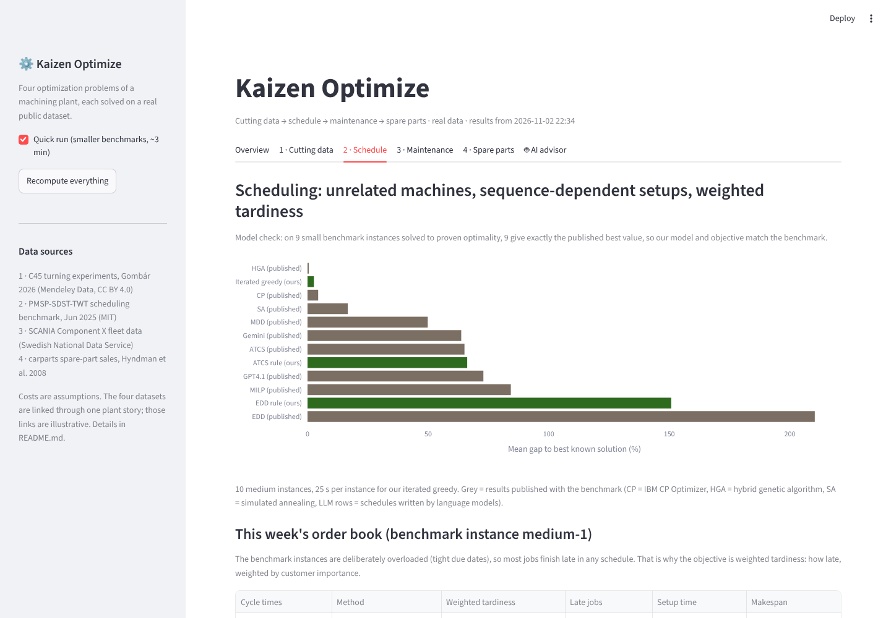
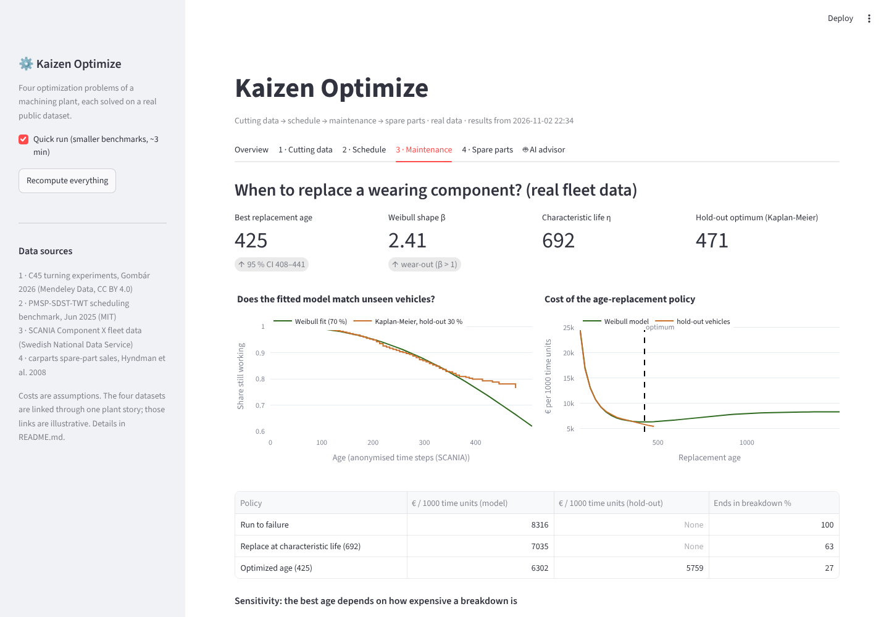
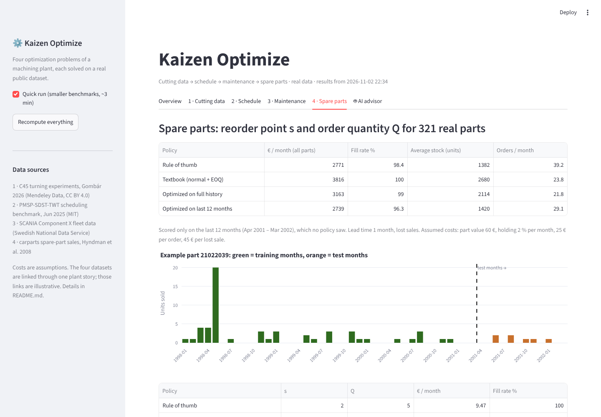

# Kaizen Optimize

**Four optimization problems of a machining plant, each solved on a real public dataset:**
cutting data → weekly schedule → maintenance → spare parts, with a dashboard and an AI advisor that explains the
plan in plain words.

Most "AI in manufacturing" work ends with a prediction. This project makes the decision: which cutting settings to
run, which job to run next on which machine, when to replace a wearing component and how much to stock. Each
optimizer is checked against a baseline on real data, and the decisions feed each other as in a real plant.



## Real data, one plant story

| Stage | Real data | Question | Method | Compared with |
|---|---|---|---|---|
| 1. Cutting data | **C45 turning experiments** (Gombár 2026, Mendeley Data): 40 designed experiments + tool-wear curves at 6 speeds | Which cutting speed, feed and number of passes give the lowest cost per part within the roughness and spindle-power limits, with only 20 trial cuts? | Roughness and Taylor tool-life model **calibrated on the experiments**, then Bayesian optimization (Gaussian process, constrained expected improvement) with the real measurement scatter | DOE + response surface, random search, handbook values |
| 2. Schedule | **Published benchmark** (Jun 2025): unrelated parallel machines, sequence-dependent setups, due dates and customer weights | Which job on which machine, in which order, to minimise weighted tardiness? | Iterated greedy local search (Ruiz & Stützle style); CP-SAT to prove optima on small instances | Published results: CP Optimizer, MILP, genetic algorithm, simulated annealing, dispatch rules, LLMs |
| 3. Maintenance | **SCANIA Component X** (Swedish National Data Service): 23,550 trucks, 2,272 repairs, 21,278 still running (censored) | At what age should a wearing component be replaced preventively? | Weibull fit with right-censoring, bootstrap confidence intervals, age-replacement optimum, hold-out check with Kaplan-Meier | Run to failure, replace at characteristic life |
| 4. Spare parts | **carparts** (Hyndman et al. 2008): monthly sales of car spare parts, 1998–2002 | Reorder point s and order quantity Q for 321 parts | Simulation-based (s, Q) optimization with common random numbers, tested on 12 months it never saw | Rule of thumb, textbook formula (normal demand + EOQ) |

**How the stages connect:** the new cutting data shortens processing times (×0.60), so this week's order book is
rescheduled with them; machines carry a wearing component, and components approaching the optimal replacement age
get a maintenance window in the schedule; the change in tool use is passed on to the spare-parts planning. The four
datasets come from different sources, so these links are part of the plant story, not one real plant (see
[Limitations](#limitations-honest)).

## Results

### 1. Cutting data: calibrated on real experiments

- **Roughness model:** ln Ra = f(ln vc, ln f, ln ap, ln vc·ln f), R² 0.95 on 40 measurements. Feed dominates; speed
  helps a little; depth of cut barely matters. Replicate scatter **±12 %**, used as the noise of every trial cut.
- **Tool life (Taylor):** T = 565 · vc^-0.32 min to flank wear VB = 0.3 mm (70–240 m/min). Tool life falls only
  slowly with speed on this machine, so the top of the measured speed range is cheapest. The real decision is feed
  against roughness, and the number of passes. The optimizer stays inside the measured range (no extrapolation).
- **Safety margin from the data:** a recommendation must be one standard deviation of the measured scatter (≈11 %)
  below the roughness limit. With a 5 % margin, some recommendations were slightly over the limit in reality.

| Part | Handbook | Recommended (Bayesian optimization) | Model optimum |
|---|---|---|---|
| A shaft | 9.36 €/part | **5.94 €** · 240 m/min, 0.137 mm, 2 passes, Ra 2.66 µm (limit 3.2) | 5.49 € |
| B flange | 7.77 € | **4.27 €** · 237 m/min, 0.135 mm, 2 passes, Ra 2.64 µm | 3.94 € |
| C pin | 3.71 € | **2.28 €** · 240 m/min, 0.115 mm, 1 pass, Ra 2.17 µm (limit 2.5) | 2.23 € |
| D axle | 18.28 € | **10.97 €** · 240 m/min, 0.137 mm, 2 passes, Ra 2.66 µm | 10.02 € |

**−40 % machining cost** for the part mix. With 20 noisy trial cuts (15 campaigns per strategy and part):

| Strategy | Median gap to model optimum | 90th percentile gap |
|---|---|---|
| **Bayesian optimization** | **4–11 %** | **8–20 %** |
| DOE + response surface | 6–19 % | 11–75 % |
| Random search | 110–194 % | 177–294 % |

Part of the Bayesian optimization gap is the deliberate safety margin. Its real advantage is reliability: DOE is
sometimes badly misled by the scatter, Bayesian optimization rarely. On the pin, whose limit is closest to what the
insert can achieve, 1 of 15 Bayesian optimization campaigns still recommended a setting slightly above the limit
(93 % within spec), which is why trial cuts near a tight limit should be confirmed before release.

### 2. Scheduling: compared with published results

**Model check:** on all 9 small benchmark instances that CP-SAT solves to proven optimality, our optimum equals the
published best value, so the objective and rules match the benchmark exactly.

On 10 instances with 54 jobs and 5 machines (25 s per instance):

| Method | Mean gap to best known solution |
|---|---|
| Hybrid genetic algorithm (published) | 0.5 % |
| **Iterated greedy (ours)** | **2.6 %** (all 10 within 0.7–5.4 %) |
| IBM CP Optimizer (published) | 4.4 % |
| Simulated annealing (published) | 16.7 % |
| ATCS dispatch rule | 65 % |
| GPT-4.1 / Gemini schedules (published) | 73 % / 64 % |
| MILP (published, time limit) | 84 % |
| EDD rule | 151–210 % |

**This week:** weighted tardiness **111,127 → 29,455 (−73 %)** from today (handbook cycle times + earliest-due-date
rule) to new cutting data + optimized sequence, with a maintenance window on machine 5. The benchmark instances are
deliberately overloaded (tight due dates), so most jobs are late in any schedule; weighted tardiness measures how late,
weighted by customer importance.

### 3. Maintenance: real fleet data

- Weibull **β = 2.41** (95 % CI 2.34–2.49): wear-out, so preventive replacement pays off. η = 692 time units.
- **Best replacement age 425** (95 % CI 408–441). The Kaplan-Meier curve of 30 % hold-out trucks (no distribution
  assumed) gives 471, and the Weibull curve matches it well up to about 400.
- **−24 % cost** compared with running to failure; 27 % instead of 100 % of components end in a breakdown.
- **Planning list:** 575 components in service are already past the replacement age, 248 more reach it soon.
- **Sensitivity:** if a breakdown costs 2× a planned repair, replace at 626; at 10×, at 242. The cost ratio
  matters as much as the statistics.

### 4. Spare parts: real demand, tested on unseen months

| Policy (321 parts, Apr 2001 – Mar 2002) | Cost per month | Fill rate | Average stock |
|---|---|---|---|
| Textbook formula (normal demand + EOQ) | 3,816 € | 100.0 % | 2,680 units |
| Optimized on the full history | 3,163 € | 99.0 % | 2,114 units |
| Rule of thumb | 2,771 € | 98.4 % | 1,382 units |
| **Optimized on the last 12 months** | **2,739 €** | 96.3 % | 1,420 units |

The lesson from real data: demand of these parts falls over their life cycle (about 2.0 units per part and month in
1998, 0.9 in the last training year, 0.6 in the test year). Every policy built on the whole history overstocks; the
textbook formula, which assumes steady normal demand, costs **39 % more**. **Which data you plan with mattered more
than the optimization method.**

| Cutting data | Schedule |
|---|---|
|  |  |
| **Maintenance** | **Spare parts** |
|  |  |

### AI advisor

A language model (Groq, Gemini, Claude, OpenAI or a local Ollama model, with automatic fallback) writes the weekly
recommendation from a numbered fact sheet produced by the optimizers. It must cite the facts, and every number in its
answer is checked; numbers that are not in the facts are flagged. The AI explains, it does not decide. Without a key,
a rule-based summary is shown.

## Run it

```bash
pip install -r requirements.txt
streamlit run app.py                 # dashboard (results are included in reports/results.json)
python -m optimize.pipeline          # recompute everything (~13 min), or --quick (~3 min)
python -m pytest                     # 18 tests
```

On Windows you can also double-click `start.bat`.

**SCANIA data:** the file is open access but has no explicit redistribution licence, so it is not in the repository.
Download `train_tte.csv` from https://doi.org/10.5878/jvb5-d390 and save it as
`data/maintenance/scania_component_x_train_tte.csv` (needed only to recompute stage 3; the dashboard works without it).

**AI advisor (optional):** copy `.env.example` to `.env` and add a free Groq key (https://console.groq.com/keys), or
run a local model with Ollama.

## Project structure

```
data/              real datasets and their sources (data/SOURCES.md)
optimize/
  calibration.py   roughness and Taylor tool-life models fitted to the C45 experiments
  plant.py         part families, cost model, trial cuts with the real measurement scatter
  process.py       DOE + RSM, random search, Bayesian optimization, benchmark
  scheduling.py    benchmark loader, dispatch rules, iterated greedy, CP-SAT model, comparison with published results
  maintenance.py   censored Weibull fit, bootstrap, Kaplan-Meier hold-out check, age replacement, planning list
  inventory.py     spare-part portfolio, (s, Q) simulation, policies, test on unseen months
  pipeline.py      runs the chain and writes reports/results.json and reports/results.md
  advisor.py       fact sheet, LLM prompt, number check, rule-based fallback
  llm.py           Groq / Gemini / Anthropic / OpenAI / Ollama with automatic fallback
app.py             Streamlit dashboard
tests/             18 tests (calibration, known-answer cases, benchmark model check, real-data checks)
```

## Limitations (honest)

- **Four datasets, one story.** The data is real, but it comes from four different sources (a lab lathe, a
  scheduling benchmark, a truck fleet, a car-parts distributor). The links between the stages (processing-time
  factor, maintenance windows, tool use) show how the decisions interact; they are not measurements from one plant.
- **Costs are assumptions.** None of the datasets has prices (machine rate, inserts, repairs, part values).
- **Cutting model:** the roughness experiment has only two levels per factor, so the model interpolates between the
  corners (leave-one-run-out error 29 %, a pessimistic check because whole corners are left out). How tool life
  depends on feed and depth of cut is not in the data and uses literature exponents. With this insert, Ra ≤ 2.0 µm is
  too close to the process capability (about 1.7 µm) for a single dry pass, so the pin limit is 2.5 µm; a tighter
  requirement would need a finishing operation. One process (one tool) per part.
- **Scheduling:** the benchmark instances are generated research instances, not a company's order book.
- **Maintenance:** time is in the dataset's anonymised units; a repair is treated as the end of a component life.
- **Spare parts:** car-parts demand stands in for the plant's spare parts; lead time 1 month, monthly review.
- The AI advisor explains the results; it does not decide. All numbers come from the optimizers.

## Data sources

See [data/SOURCES.md](data/SOURCES.md) for full citations and licences: Gombár 2026 (CC BY 4.0), Jun 2025 (MIT),
Kharazian et al. 2025 (open access via SND), Hyndman et al. 2008 (R package expsmooth).

## Author

Vikram Ejjagiri, M.Eng. Applied AI for Digital Production Management (TH Deggendorf).
Part of the Kaizen Matrix series of industrial AI projects.
